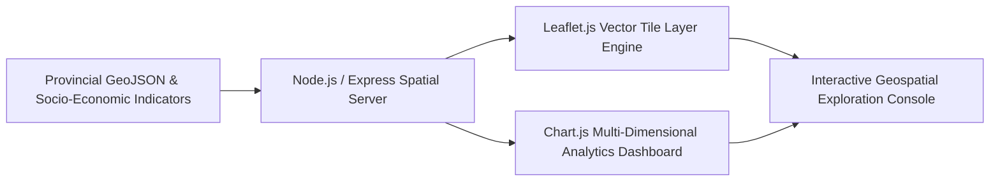

# Ombres Numériques - Regional Infrastructure Intelligence & Spatial GIS

[](https://nodejs.org/)
[](https://leafletjs.com/)
[](https://www.chartjs.org/)
[](https://opensource.org/licenses/MIT)

A spatial demographic analysis and Geographic Information System (GIS) designed to visualize, model, and quantify infrastructure access disparities across Moroccan provinces.

---

## Analytical Methodology

The platform computes a composite Infrastructure Vulnerability Index ($V_i$) for each geographic territory $i$:

$$V_i = \sum_{k=1}^{m} w_k \cdot \left(1 - \frac{x_{i,k} - \min(X_k)}{\max(X_k) - \min(X_k)}\right)$$

where:
- $x_{i,k}$ represents the observed coverage of infrastructure metric $k$ (e.g., educational access, digital connectivity, healthcare coverage, electricity distribution).
- $w_k$ denotes the indicator weight constraint: $\sum_{k=1}^m w_k = 1$.

Territories exhibiting high composite vulnerability scores are dynamically highlighted through categorized choropleth color bands.

---

## Platform Architecture



---

## Installation & Deployment

```bash
# Clone the repository
git clone https://github.com/yasmenmad/ombres-numeriques.git
cd ombres-numeriques

# Install dependencies
npm install

# Start Express server
node backend/server.js
```

Access the geospatial portal at `http://localhost:3000`.

---

## Author

- **Developer:** Yasmine Daoudi
- **Focus:** Spatial Data Systems, Geo-Demographic Modeling, and Interactive Data Visualization
